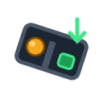

<p align="center">
  
</p>

# GraviBall

A simple 2D physics game: deliver a ball to the exit zone by **rotating the whole
level** (smooth, any angle) — you never control the ball directly.

Built with HTML5 + TypeScript + Vite, pure SVG rendering, JSON levels and
Local Storage persistence. No runtime dependencies.

## Run

```bash
npm install
npm run dev      # dev server
npm run build    # type-check + production build
npm run preview  # serve the production build
```

## Controls

| Input              | Action            |
| ------------------ | ----------------- |
| Mouse wheel        | Rotate the level  |
| Drag on the field  | Rotate the level  |
| ← → / A D          | Rotate (hold)     |
| R                  | Restart level     |
| P / Esc            | Pause             |
| ↑ ↓ + Enter        | Level select navigation |
| ← → + Enter        | Level-complete menu (Retry / Next / Levels) |

### Mobile mode

On touch devices the game automatically switches to mobile mode (toggle:
Menu → "Mobile mode: auto / on / off", stored in Local Storage):

- The maze stays **fixed**; the **gravity direction** rotates instead.
- Gravity follows the **device orientation** (Gyro button in the HUD;
  iOS permission prompt on first enable). If no orientation readings
  arrive, gyro is disabled automatically.
- Big on-screen **◀ ▶ hold-buttons** are always available as the fallback.
- Portrait orientation is blocked with a "rotate your device" overlay.

## Level elements

- **Walls** (gray) — solid, slight bounce
- **Sticky walls** (honey) — grab the ball until gravity pulls it free
- **Bouncy walls** (orange) — throw the ball back with extra pop
- **Spikes** (red) — instant death
- **Moving traps** (pink, ⚠) — patrol a path on a sine timer, instant death
- **Accelerating zones** (blue arrows) — push the ball in a direction
- **Braking zones** (brown hatch) — exponential drag
- **Coins** (gold) — optional, tracked in highscores
- **Notes** (📜) — reveal fragments of *The Ball's Story* (Menu → Story)
- **Exit zone** (green, pulsing) — deliver the ball here to win

## Content

- 10 built-in levels (JSON in `src/levels/`, one file per level)
- Global config in `src/config.json` (gravity, friction, sensitivities…)
- Highscores per level (best time, most coins, fewest deaths) in Local Storage
- Story progress in Local Storage
- **Level editor**: draw walls/traps/zones, drag to move, edit properties,
  save to Local Storage (playable from the level select), export/import JSON

## Project layout

```
index.html            app shell (screens)
src/
  main.ts             screen navigation, level select, scores, story
  game.ts             physics engine + SVG renderer + HUD
  editor.ts           level editor
  levels.ts           built-in levels (JSON)
  levels/*.json       10 level definitions
  config.json         tuning knobs
  storage.ts          Local Storage helpers
  story.ts            note texts
  types.ts            shared types
```

## Level JSON format

```json
{
  "id": "l01",
  "name": "First Steps",
  "size": [960, 540],
  "start": [150, 100],
  "goal": { "x": 750, "y": 420, "w": 150, "h": 80 },
  "walls": [{ "x": 0, "y": 0, "w": 960, "h": 30 }],
  "sticky": [{ "x": 80, "y": 220, "w": 240, "h": 20 }],
  "bouncy": [{ "x": 620, "y": 320, "w": 220, "h": 25 }],
  "spikes": [{ "x": 200, "y": 315, "w": 560, "h": 25 }],
  "zones": [
    { "type": "accel", "rect": { "x": 0, "y": 0, "w": 100, "h": 50 }, "dir": [1, 0], "power": 3000 },
    { "type": "brake", "rect": { "x": 0, "y": 0, "w": 100, "h": 100 }, "dir": [0, 0], "power": 4 }
  ],
  "movers": [{ "w": 30, "h": 280, "from": [480, 30], "to": [480, 300], "period": 3, "phase": 0 }],
  "coins": [{ "x": 400, "y": 460 }],
  "notes": [{ "x": 480, "y": 140, "id": "n1" }],
  "parTime": 10
}
```
